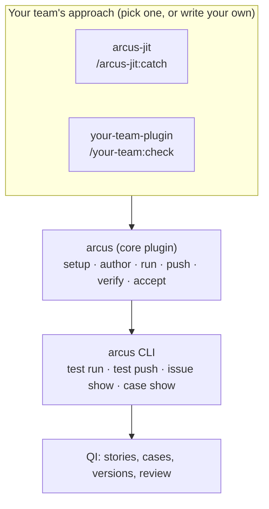
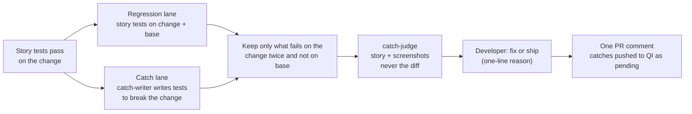

# arcus-jit: catch a change before review

`/arcus-jit:catch` tests a change on the developer's own stack before anyone reviews it. It follows Meta's
[just-in-time catching tests (JiTTesting)](https://engineering.fb.com/2026/10/29/security/catching-bugs-before-they-land-jittestings-human-on-the-loop-approach-at-full-scale/):
tests written for one change, meant to fail if it broke something, judged before a person is asked.

It is **one way to test**, packaged as its own plugin. The core `arcus` plugin stays neutral.

## Plugins, by layer



| Layer | What it holds | Opinion about testing |
|---|---|---|
| `arcus` CLI | Runs tests, pushes them, reads issues and cases | None |
| `arcus` plugin | Teaches an agent the CLI and the QI workflow | None |
| `arcus-jit` plugin | One approach: compare with the base, try to break it, judge, fix or ship | Yes, this one |
| Your plugin | Your team's approach, on the same CLI | Yours |

**Rules for what goes where:**
- QI keeps only its workflow contract: stories, cases, versions, pushes, accepting.
- Anything that thinks (writing tests, judging failures, deciding what blocks) lives in a plugin.
- The core plugin never says *how* to test. An approach that some teams wouldn't want is a separate plugin.

## What `/arcus-jit:catch` does



- **Regression lane:** the story's own tests. A story case that breaks blocks the merge, unless it's fixed.
- **Catch lane:** a separate agent, in a fresh session, writes tests meant to fail if the change broke something. A
  failing one is a *catch*. Catches are advisory.
- **The base** is the merge base, served on the same stack by a repo script. It is never a deployed environment.
- **The judge** sees the story, the test, each build's outcome and screenshots. It never sees the diff.
- **The developer is on the loop, not in it:** they only decide fix or ship for each catch.

## Use it

```bash
claude plugin marketplace add testsigmahq/arcus-claude-plugin
claude plugin install arcus@testsigma
claude plugin install arcus-jit@testsigma
```

Then, in the repo, once the story's tests pass:

```
/arcus-jit:catch TMP-1815
```

## Set it up for a repo: `arcus-jit.json`

Put it next to `arcus.json` and commit it. It names environment variables, never secrets.

```json
{
  "url": "http://dev-arcus.testsigma.com",
  "base": {
    "serve": "./jit-base.sh base",
    "restore": "./.arcus/jit/jit-base.sh back",
    "branch": "dev"
  },
  "vars": { "email": "ARCUS_E2E_EMAIL", "password": "ARCUS_E2E_PASSWORD" },
  "budget": "low",
  "catch": "auto",
  "rubric": "jit-rubric.md"
}
```

| Knob | Example use |
|---|---|
| `base.serve` / `base.restore` | Your repo's way to serve the merge base. The Arcus UI checks it out and lets `next dev` serve it (`apps/ui/e2e/sigma/jit-base.sh`) |
| `budget` | `low` = 20 min / 8 tests, `high` = 45 min / 20 tests |
| `catch` | `off` for a repo that only wants the regression lane |
| `rubric` | Your bar for a bug, read by the judge. For example: "a page that takes over 3 s is a bug", "copy changes are intended" |

Want more than these knobs (another lane, another judge, another bar for blocking)? That's a different approach: write
your own plugin.

## What the PR comment looks like

```markdown
### Arcus JiT: checked against the base, and caught

Story **TMP-1815**: Agents and Profiles

**Blocks the merge:** 1 of the story's cases broke on this PR.

**Catching tests:** 7 written, 6 caught something (advisory, they don't block). Shipping 1: "copy owned by marketing".

Ran locally by the developer, not a CI result: the change and its merge base, one after the other, at `http://dev-arcus.testsigma.com` in 13 min.
```

Each catch below that has the judge's reason, what happened on each build, and steps to reproduce.

## Write your own approach

A team plugin is a folder with a manifest and a skill. It uses the core plugin and the CLI.

```
plugins/your-team/
  .claude-plugin/plugin.json
  skills/check/SKILL.md
```

```markdown
---
name: check
description: Use when a developer asks to check their change the your-team way.
---
1. `arcus issue show <key> --json` for the story and its cases.
2. Run the tests your team cares about with `arcus test run <file> --json`.
3. Decide what a failure means your way. Report it your way.
```

Some approaches a team might take instead:
- **Risk-only:** write tests just for the files a diff touches, no story needed.
- **Contract-first:** run API tests against a mock before any UI test.
- **No agent judge:** list every failure for a person to triage.

## How it was proven

On a local Arcus stack, a change with two planted bugs (a renamed tab query key, and search made case-sensitive) on
story TMP-1815:
- **Regression lane:** the story test that covers tabs failed twice on the change, passed on the base, and blocked.
- **Catch lane:** 7 catching tests in 13 minutes, 6 catches, all caused by the two planted bugs.
- **Judge:** every catch judged `real_bug` from the story and screenshots alone.
- **Base:** the merge base was served and the branch restored.
